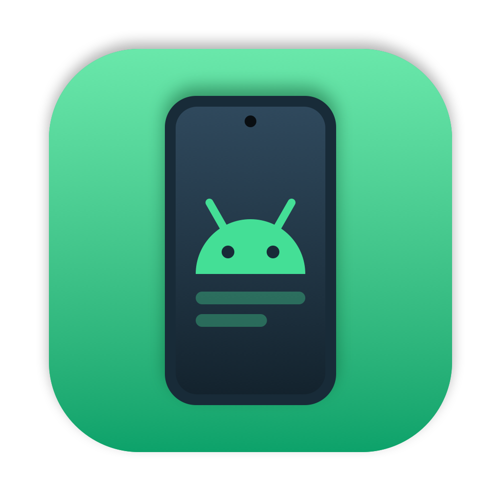

<p align="center"></p>

# Tether

A small desktop app for using your Android phone from your computer, built on
[scrcpy](https://github.com/Genymobile/scrcpy).

- **Mirror** the phone's screen in a window (one per phone), and control it with your mouse and
  keyboard; the phone's audio plays on the computer (Android 11+).
- **Open apps in their own windows**: pick an app from a grid of your phone's apps and it opens on
  a separate virtual display, sized like a desktop window (Small, Medium, Large or the phone's own
  size, portrait or landscape) and resizable. Needs Android 10+.
- **Notifications**: see the phone's notifications. Click one to open it on the phone's screen,
  mirrored: with [Tether Buddy](#tether-buddy) it does what tapping it does (e.g. opens that chat);
  without, the notification shade opens for you to tap it there.
- **Clipboard**: send your computer's clipboard to the phone, or copy the phone's to the computer.
- **Files**: browse the phone's storage; open, download, upload (or drop files in), rename, delete
  and make folders.
- **Control panel**: storage, memory, battery health and temperature, chipset, display and more;
  take screenshots, install APKs (or drop them on the window), press Back/Home/Volume/Power, switch
  dark mode, Do Not Disturb or "stay awake", open a link on the phone, and restart it.
- **App actions**: right-click an app to see its info on the phone, force stop it, clear its data or
  uninstall it.
- **Photos**: the newest photos and videos from the camera and screenshots; click to open, or download.
- **USB or Wi-Fi**: pair over Wi-Fi with a pairing code (Android 11+), or switch a USB-connected
  phone to Wi-Fi with one click; Tether reconnects to it next time.
- **Several phones** at once.
- **Capture Mouse** for games: the mouse acts as a real mouse on the phone (relative movement,
  pointer capture). Press Left Alt (or ⌘ / Super) to release it.
- **Sets itself up**: downloads the latest scrcpy (with adb) on first run, checks for updates, and
  can use Android Studio's or your system's adb instead.

| Platform | App | Status |
|---|---|---|
| macOS 26+ (Apple Silicon) | SwiftUI with Liquid Glass | ✅ Works |
| Linux (GNOME 46+, e.g. Fedora 40+, Ubuntu 24.04+) | GTK4 + libadwaita | ✅ Works (tested on Fedora 44, x86_64) |
| Windows 10/11 (x64, ARM64) | WinUI 3 | ✅ Works (tested on Windows 11 ARM) |

[`python/`](python/) has the original Qt version this grew out of; it's no longer maintained.
See [ROADMAP.md](ROADMAP.md) for known limitations and what's next.

## Requirements

- An Android phone with **USB debugging** turned on (Settings → About phone → tap *Build number*
  7 times, then Developer options → USB debugging). Android 5+ for mirroring, Android 10+ for app
  windows.
- On Linux, Tether downloads scrcpy for x86_64 only; on other CPUs install scrcpy 3.0+ yourself
  (e.g. from your package manager) and choose it during setup.

## Install

Download the latest release from the [Releases](../../releases) page:

| Platform | File |
|---|---|
| macOS 26+ (Apple Silicon) | `Tether-<version>-macos.dmg`: open it and drag Tether to Applications. |
| Windows | `Tether-<version>-windows-x64-setup.exe` (or `-arm64-`), or the `.zip` to run without installing. |
| Linux (Debian, Ubuntu) | `tether_<version>_amd64.deb` (or `arm64`): `sudo apt install ./tether_*.deb` |
| Linux (Fedora, openSUSE) | `tether-<version>-1.x86_64.rpm` (or `aarch64`): `sudo dnf install ./tether-*.rpm` |
| Linux (other) | `tether-<version>-linux-x86_64.tar.gz` (or `arm64`): the `tether` binary, with a `.desktop` file and icon. |

The builds aren't signed yet, so the first launch needs a click more:

- **macOS** blocks the app at first: right-click it and choose **Open**, or run
  `xattr -dr com.apple.quarantine /Applications/Tether.app`.
- **Windows** SmartScreen may warn about an unknown publisher: choose **More info → Run anyway**.

## Using it

1. On first launch, the setup wizard downloads scrcpy and picks an adb.
2. Connect your phone with USB and accept the *Allow USB debugging?* prompt on the phone. For Wi-Fi,
   use **Pair** (Developer options → Wireless debugging → *Pair device with pairing code*), or
   press **Go Wireless** while connected by USB.
3. The sidebar shows the phone (switch phones or pair one from its menu) and its sections:
   **Overview** (status, controls and details), **Apps** (click one to open it in its own window),
   **Notifications**, **Photos** and **Files**. **Mirror Screen** in the toolbar shows the
   whole screen. **Refresh** reloads the app list; it's cached until then.

| | macOS | Linux / Windows |
|---|---|---|
| Mirror Screen | ⇧⌘M | Ctrl+Shift+M |
| Refresh | ⌘R | Ctrl+R |

### Tips

- **Window size** (above the app grid): sizes are in points, like any other window, and shrink to
  fit your screen. *Text size* makes the app's content smaller or larger. *Portrait* suits most
  phone apps.
- **Resizable** app windows relayout the app as you resize them. On a Mac they aren't as sharp on
  Retina screens (a scrcpy limitation); turn Resizable off for the sharpest picture.
- **Settings** can turn the phone's audio off, or turn its screen off while it's shown (private on
  your desk, and it saves battery). Controls a phone's Android version can't do are disabled.
- **Capture Mouse** in app windows turns on the phone's *Force desktop mode* developer option so the
  mouse shows up on the app's display instead of the phone screen. You can turn it off again in
  Developer options. Capture Mouse itself is off each time Tether starts.
- **Copying the phone's clipboard** needs a phone that lets adb read it in the background; Xiaomi
  phones don't. Sending to the phone works everywhere.
- Some phones (e.g. Xiaomi/MIUI) need **USB debugging (Security settings)** turned on before the
  mouse and keyboard work, and **Install via USB** before APKs (or Tether Buddy) can be installed.

### Tether Buddy

Tether works with nothing installed on the phone. **Tether Buddy** is an optional, tiny companion
app (no screens, no internet access) for the few things adb can't do on its own: Android only lets an
installed app see a notification's action. With Buddy, clicking a notification runs that action. Tether
offers to install it in the Notifications section, and turns it on over adb; you can uninstall it like
any other app.

## Building from source

```sh
git clone https://github.com/MSaudTahir/tether.git
cd tether
```

All platforms need [Rust](https://rustup.rs).

### macOS

Needs Xcode 26.

```sh
macos/build.sh                 # → macos/build/Tether.app
open macos/build/Tether.app
```

`build.sh` builds the Rust core as a static library, generates its Swift bindings with
[UniFFI](https://mozilla.github.io/uniffi-rs/), builds the app with SwiftPM, and puts together the
`.app` bundle (ad-hoc signed). Data (scrcpy, the app cache, settings) lives in
`~/Library/Application Support/io.github.msaudtahir.Tether`.

### Linux

Needs the GTK4 and libadwaita development packages:

```sh
sudo dnf install gtk4-devel libadwaita-devel       # Fedora
sudo apt install libgtk-4-dev libadwaita-1-dev     # Debian / Ubuntu

cd linux
cargo run --release
```

The Linux app uses the Rust core directly. Data lives in `~/.local/share/tether`.

### Windows

Needs:

- Visual Studio 2022 Build Tools with *Desktop development with C++* (the x64 and/or ARM64 MSVC
  tools) and the Windows 11 SDK
- the [.NET 9 SDK](https://dotnet.microsoft.com/download)
- on ARM64 Windows, [LLVM](https://github.com/llvm/llvm-project/releases) (clang)
- [uniffi-bindgen-cs](https://github.com/NordSecurity/uniffi-bindgen-cs), which generates the C#
  bindings:

  ```sh
  cargo install uniffi-bindgen-cs --locked --git https://github.com/NordSecurity/uniffi-bindgen-cs --tag v0.10.0+v0.29.4
  ```

```powershell
windows\build.ps1               # → windows\build\Tether-<arch>\Tether.exe  (-Arch x64|arm64)
```

`build.ps1` builds the core as a DLL, generates its C# bindings and publishes a self-contained
folder (no installer or runtime needed). Data lives in `%LOCALAPPDATA%\Tether`.

### Project layout

One shared core holds all the logic; each platform gets a thin native UI on top of it.

| Folder | What |
|---|---|
| [`core/`](core/) | Rust: adb, scrcpy download and updates, the app and icon cache, device info and controls, notifications, files, clipboard, pairing, scrcpy windows, settings. |
| [`macos/`](macos/) | SwiftUI app with Liquid Glass. |
| [`linux/`](linux/) | GTK4 + libadwaita app in Rust. |
| [`windows/`](windows/) | WinUI 3 app in C#. |
| [`helper/`](helper/) | A tiny program that runs on the phone (via `app_process`, nothing installed) to list apps with their icons, use the clipboard, and run notification actions with Buddy's help. The core embeds the built `helper.dex`. |
| [`buddy/`](buddy/) | Tether Buddy, the optional companion app (a notification listener). The core embeds the built `buddy.apk`. |
| [`icon/`](icon/) | The app icon and the script that draws it (`swift icon/make_icon.swift icon/icon.png`). |
| [`python/`](python/) | The original Qt app (no longer maintained). |
| [`.github/workflows/`](.github/workflows/) | CI for each platform, and the release build. |

Contributions are welcome: see [CONTRIBUTING.md](CONTRIBUTING.md) for how it's organized and the
rules.

### Core

```sh
cd core
cargo test
cargo run --example smoke -- /tmp/tether-data   # runs everything against a connected phone
```

Core calls block (they run adb, scrcpy or downloads), so the UIs call them off the main thread.

### Helper and Buddy

`helper/helper.dex` and `buddy/buddy.apk` are checked in, so you only need this if you change them.
`helper/build.sh` and `buddy/build.sh` rebuild them; they need a JDK and the Android SDK (`d8`, and
for Buddy `aapt2`, `zipalign` and `apksigner`). Buddy's signing key isn't in the repo: `build.sh`
uses `buddy/tether-buddy.keystore` (or `$BUDDY_KEYSTORE`) and makes a new key if there is none. Phones
only update Buddy when it's signed with the same key, so a Buddy built with another key has to be
uninstalled from the phone first.

## License

Tether is licensed under the [Apache License 2.0](LICENSE).

## Thanks

Special thanks to [**Genymobile**](https://www.genymobile.com) (the makers of Genymotion) and
[Romain Vimont](https://github.com/rom1v) for [**scrcpy**](https://github.com/Genymobile/scrcpy).
All the mirroring, control and virtual display magic is scrcpy; this app is just a friendly front
end for it. If you find it useful, consider [supporting its author](https://github.com/sponsors/rom1v)
too.

scrcpy is licensed under the Apache License 2.0. Tether downloads official scrcpy releases from
GitHub (verifying their SHA-256 checksums) rather than redistributing it.

Android is a trademark of Google LLC. The Android robot is reproduced or modified from work created
and shared by Google and used according to terms described in the Creative Commons 3.0 Attribution
License. This project isn't affiliated with Google or Genymobile.
